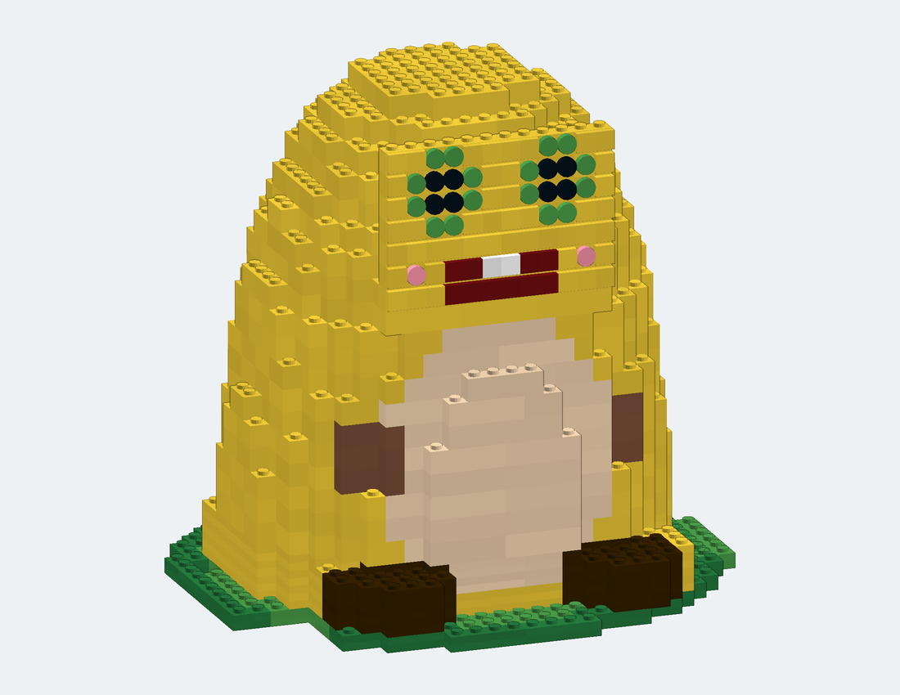

# lego-moc-builder

让 AI 自主设计**真的拼得起来**的乐高 MOC。


奶蛙（1485 件，SNOT 脸墙 + 荷叶底座）：



## 它解决什么问题

直接让大模型输出 LDraw 坐标，结果几乎总是错的：零件悬空、互相重叠、零件号不存在、窗户比墙洞大。
这个工具包把"设计"和"几何正确性"拆开：

```
布局与造型（LLM 决定）  →  网格化放置（Model 强制约束）  →  结构校验（check 判定）  →  渲染（render 回看）
```

模型只需要给出**凸点/板层的整数坐标**和房间划分；能不能拼由确定性代码说了算。

## 特性

- **网格化建模**：凸点级坐标、整数板层，自动处理 LDraw 的零件原点/旋转/包围盒。
- **SNOT 侧向连接**：`place_on_stud()` 直接把零件吸到任意凸点（含 11211/87087/99207 的侧凸点），
  从 LDraw 几何里解析真实凸点位置/方向，支持竖着贴脸、侧向拼花纹。
- **结构校验**：悬空件（`floating`）、脱地块（`orphans`）、无承接的 SNOT 件
  （`snot_unsupported`）、支撑面积（`weak`）。
- **软渲染**：numpy z-buffer + 方向光 + 边缘增强，无 GPU、无 GUI，单张 0.5–10 秒。
- **真实零件库**：直接读 BrickLink Studio 自带的 LDraw 库（含 Studio 的 `UnOfficial` 更新件）。
- **导出**：`.ldr`（Studio / LDView / LeoCAD 可直接打开，含 `0 STEP`）+ `bom.csv`。

## 安装

```bash
pip install numpy pillow
git clone https://github.com/ancientrain/lego-moc-builder.git
cd lego-moc-builder
python3 scripts/index_parts.py        # 建立零件索引（约 1 秒）
```

零件库定位顺序：`$LDRAW_DIR` → `C:\Program Files\Studio 2.0\ldraw`（WSL 下自动映射到 `/mnt/c/...`）
→ `~/lego/lib/usr/share/ldraw` → `/usr/share/ldraw`。

## 使用

```bash
python3 examples/build.py cottage     # 236 件小房子
python3 examples/build.py house       # 花园洋房
python3 examples/build.py villa       # 750 件三层别墅（可分层）
python3 examples/build.py milkfrog    # 1485 件奶蛙（SNOT 脸墙 + 荷叶）
```

输出：`out/<name>/{name}.ldr, bom.csv, preview-iso.png, preview-front.png}`。

自己写设计：

```python
from paths import find_ldraw
from ldrawlib import Library
from model import Model
import check, render

m = Model(Library(find_ldraw()), 20, 14)      # 地块 20×14 凸点
for x in range(0, 20, 4):                      # 一圈 1×4 砖
    m.place("3010", 15, x, 0, 1)
check.print_report(m)                          # floating 必须是 0
render.render(m, "preview.png", az=30, el=28)
open("model.ldr", "w").write(m.to_ldr("demo"))
```

SNOT 侧向连接：

```python
m.place("3020", 10, 0, 0, 0)
host = m.place("11211", 14, 2, 0, 1)     # 1×2 砖，两个侧凸点朝 -Z
m.place_on_stud("3070b", 0, host, 0)     # 瓷砖竖着吸到侧凸点
check.print_report(m)                    # snot_unsupported / floating 都要为 0
```

## 示例

| 文件 | 件数 | 内容 |
|---|---|---|
| `examples/cottage.py` | 236 | 白色联排小楼：门窗、平顶、檐口、花池 |
| `examples/house.py` | 295 | 带花园的房子：真实门框/窗框、室内家具、33° 斜顶、围栏 |
| `examples/villa.py` | 750 | 三层别墅：客厅/餐厅/厨房/卫浴/2 卧室/书房/阁楼、车库+汽车+摩托、5 个人仔、可分层的街景式结构 |
| `examples/milkfrog.py` | 1485 | 奶蛙：黄胖子 + 奶油肚皮 + 绿眼睛 + 大笑嘴，SNOT 脸墙、荷叶底座、手脚 |

## 已知限制

- 旋转只支持 90° 步进（24 种轴对齐姿态）；任意斜角、铰链角度暂不支持。
- SNOT 校验基于“凸点 + 底面承口”的几何配对，不模拟夹子、插销、齿轮等非凸点连接。
- 侧凸点行距是 3 板（24 LDU），而竖直贴片高度是 20 LDU，行与行之间会留 4 LDU 缝；
  不要用 2×2 贴片跨两行，会重叠。
- 家具是"示意级"配方，不是官方套装的精细度。
- 不生成 PDF 说明书；`.ldr` 里的 `0 STEP` 可交给 Studio / LPub3D 出图。

## 许可

- 代码：MIT（见 `LICENSE`）。
- 示例模型与文档：CC BY 4.0。
- LDraw 零件库：CC BY 4.0，版权归 LDraw.org 贡献者；LEGO® 是 LEGO Group 的商标，
  本项目与其无关联。
